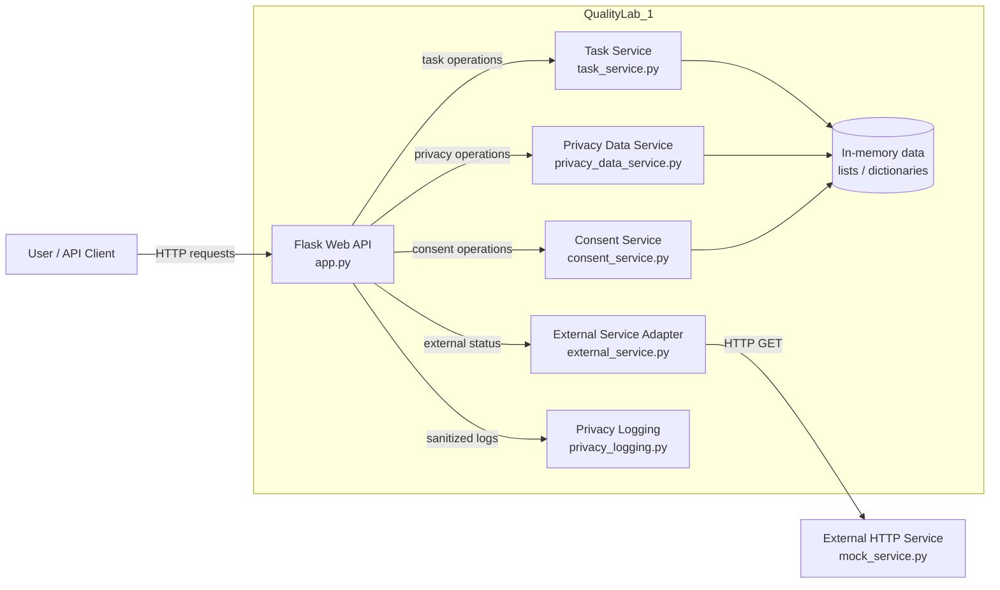
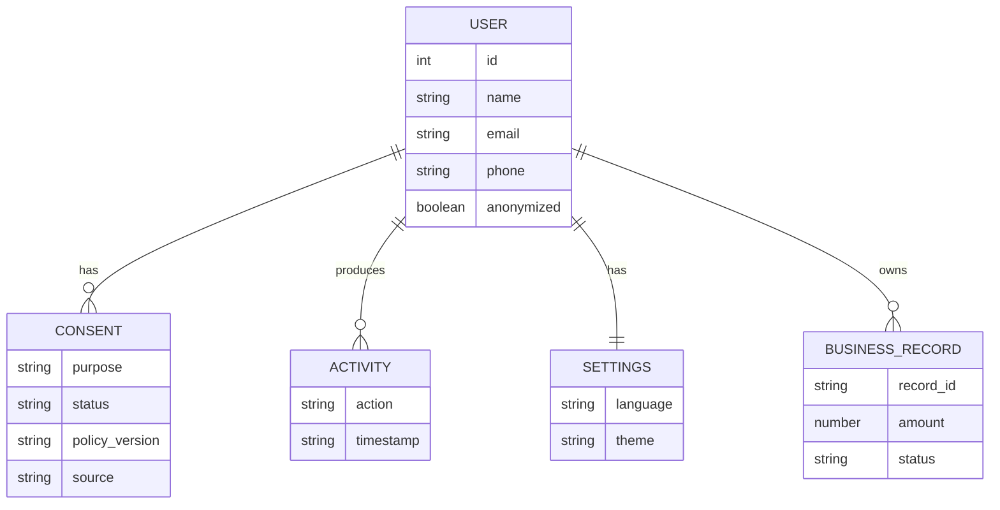

# System Design Document (SDD)

## 1. Призначення системи

QualityLab_1 — навчальний Python-проєкт для дослідження якості, надійності, приватності та супроводу програмних систем.

Основний вебконтур реалізований на Flask.

Система містить:
- Flask Web API — app.py
- Task Service — task_service.py
- Privacy Data Service — privacy_data_service.py
- Consent Service — consent_service.py
- External Service Adapter — external_service.py
- Privacy Logging — privacy_logging.py
- тестовий зовнішній сервіс — mock_service.py

## 2. C4 Container Diagram

Діаграма відображає взаємодію клієнта, Flask API, внутрішніх сервісів, in-memory сховища та зовнішнього HTTP-сервісу.

## 3. Компоненти системи

### Flask Web API
Файл: app.py
Приймає HTTP-запити, викликає сервіси та формує JSON-відповіді.

### Task Service
Файл: task_service.py
Виконує створення, завершення, фільтрацію та аналіз задач.

### Privacy Data Service
Файл: privacy_data_service.py
Виконує експорт персональних даних, отримання privacy state та анонімізацію.

### Consent Service
Файл: consent_service.py
Керує наданням, відкликанням та історією згод користувача.

### External Service Adapter
Файл: external_service.py
Реалізує HTTP-запити, retry, timeout, backoff та fallback.

## 4. Модель даних

Постійна база даних відсутня. Дані зберігаються у списках та словниках Python у памʼяті процесу.

Основні сутності:
- User
- Task
- Consent
- Activity
- Settings
- Business Record

## 5. API Contracts

- GET /health
- GET /tasks/summary
- GET /privacy/log-demo
- GET /api/users/{subject_id}/personal-data
- GET /api/users/{subject_id}/privacy-state
- POST /api/users/{subject_id}/anonymize
- POST /api/users/{user_id}/consents/{purpose}/grant
- POST /api/users/{user_id}/consents/{purpose}/revoke
- GET /api/users/{user_id}/consents/history
- POST /api/users/{user_id}/optional-action/{purpose}

## 6. Архітектурні обмеження

- дані зберігаються in-memory;
- після завершення процесу дані втрачаються;
- Flask API запускається локально;
- зовнішній сервіс є тестовою залежністю.

STATUS: SDD DRAFT

## 7. C4 Container Diagram — Mermaid

## 8. ER Data Model — Mermaid

### GET /api/system/info

Призначення: повернення службової інформації про поточну версію API.

HTTP status: 200.

Response fields:
- service;
- api_version;
- status.

## Knowledge Links

- [[isd|ISD]]
- [[adr/ADR-0001-python-flask|ADR-0001 — Python + Flask]]
- [[adr/ADR-0002-in-memory-storage|ADR-0002 — In-Memory Storage]]
- [[../developer/CONTRIBUTING|Developer Contributing Guide]]

#architecture #api
